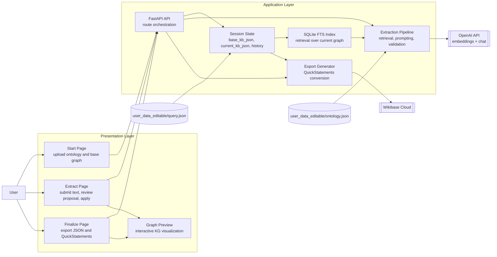
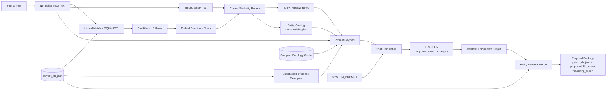
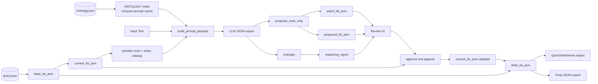

# TriExtract Thesis Graph Pack

This is the canonical architecture pack for explaining TriExtract in a thesis, demo, or handover.
The intent is to keep one clear figure set with one main message per figure instead of maintaining overlapping versions of the same story.

Use `thesis_graphs.drawio` as the editable source and this file as the speaking guide for what each figure is meant to communicate.
The pack is written so that a reader can understand the artifact even if they never open the codebase.

At the highest level, the four figures should communicate one consistent story:

1. TriExtract starts from an ontology and an optional base graph.
2. It retrieves relevant graph context before calling the chat model.
3. The model produces a proposal, not a direct graph mutation.
4. Only approved rows enter the working graph, and the export path is centered on the session delta.

## How To Use This Pack

| Figure | Best use | Core claim |
| --- | --- | --- |
| Figure 1. Artifact Overview | Intro, demo, artifact presentation | TriExtract is a human-in-the-loop artifact connecting UI, state, extraction, and export. |
| Figure 2. Retrieval-Informed Proposal Generation | Method, design rationale, AI explanation | The chat model is constrained by ontology and retrieved graph context; embeddings are used only for retrieval. |
| Figure 3. State And Data Objects | Architecture, implementation transparency | The system is built around explicit JSON state transitions rather than opaque model output. |
| Figure 4. Review, Approval, And Deployment Loop | Evaluation, control, deployment discussion | Graph growth happens through iterative review and append, with export separated from extraction. |

## Recommended Reading Order

If someone sees the pack for the first time, the easiest sequence is:

1. Figure 1 for the artifact overview
2. Figure 2 for the AI and retrieval explanation
3. Figure 3 for the important JSON objects and state transitions
4. Figure 4 for the human review and deployment logic

This order works well because it moves from user-facing behavior to implementation logic, then to deployment control.

## Diagram Conventions

Use these conventions consistently across the draw.io file and the thesis text:

- Rounded rectangles represent pages, processing steps, or logical components.
- Cylinders represent stored files or persistent JSON-like state objects.
- Double-bracket boxes represent external systems such as OpenAI or Wikibase.
- Arrows represent the main direction of information or control flow.

Keep these labels stable across figures:

- `proposal` means a generated result waiting for approval
- `current_kb_json` means the working graph after approvals
- `delta_kb_json` means the net session contribution
- `patch_kb_json` means the rows actually applied on approval
- `QuickStatements` means deployment output, not the working graph itself

## Core Terms

| Term | Meaning in the implementation | Why it matters in the thesis |
| --- | --- | --- |
| `base_kb_json` | The session seed graph, usually loaded from `query.json` or an uploaded base graph | Defines the starting state of the artifact instance |
| `current_kb_json` | The mutable working graph after one or more approvals | Represents the artifact's evolving internal state |
| `delta_kb_json` | `rows_delta(base_kb_json, current_kb_json)` | Represents the net contribution produced during one session |
| `proposal` | A generated extraction result stored before approval | Supports the human-in-the-loop review step |
| `patch_kb_json` | The rows actually applied on approval | Separates reviewable patch state from the full merged preview |
| `proposed_kb_json` | The merged preview graph shown to the reviewer before approval | Explains why the UI can show a full preview while approval still applies only a patch |
| `reasoning_report` | Structured explanation of why the proposal rows were suggested | Makes the review step intelligible and supports traceability |
| Two-step QuickStatements | Export mode where unresolved placeholders are created first and then bound in Step 2 | Handles Wikibase Cloud import constraints |

## Figure 1. Artifact Overview

Use when:
Introducing the artifact at a high level in a results, demo, or overview chapter.

Main message:
TriExtract combines user interaction, session state, ontology-constrained extraction, and Wikibase deployment in one review-centered workflow.

Suggested caption:
High-level overview of the TriExtract artifact, showing how user interaction, backend orchestration, AI-assisted extraction, and Wikibase export fit together.



What to say:

- The artifact has three visible stages: setup, extraction, and finalization.
- The user never writes directly to Wikibase; TriExtract always inserts a review step first.
- Session state is the backbone of the artifact because approved rows become the context for later rounds.
- This figure is intentionally broad; it should explain the shape of the artifact, not every intermediate data object.

Implementation anchors:

- `app.py`
- `backend/api.py`
- `backend/state.py`
- `backend/extractor/pipeline.py`
- `backend/quickstatements.py`

## Figure 2. Retrieval-Informed Proposal Generation

Use when:
Explaining how the AI component is constrained and why this is more than a raw LLM wrapper.

Main message:
Embeddings are used only to retrieve and rerank relevant graph context, while the chat model performs the actual structured extraction.

Suggested caption:
Retrieval-informed proposal generation in TriExtract, separating graph-context selection from ontology-constrained chat extraction.



What to say:

- The model does not receive raw text alone; it receives ontology constraints and retrieved graph context.
- The embedding model helps choose context rows but does not generate triples directly.
- Existing entities are surfaced to the model before generation so reuse is encouraged earlier, not only patched afterward.
- Validation and merge still happen after generation, so the model is constrained both before and after the chat call.

Implementation anchors:

- `backend/extractor/context.py`
- `backend/extractor/pipeline.py`
- `backend/extractor/postprocess.py`
- `backend/core/prompt.py`
- `backend/core/config.py`

## Figure 3. State And Data Objects

Use when:
Explaining the implementation through its main JSON objects and how data moves through the system.

Main message:
TriExtract is a pipeline of explicit state objects and transformations, not a black-box LLM call.

Suggested caption:
Main state objects and transformations in TriExtract, from uploaded ontology and source text to session delta and importable QuickStatements.



What to say:

- `current_kb_json` is the evolving working graph used as future retrieval context.
- `delta_kb_json` is the net session contribution and is the main export object.
- `patch_kb_json` is not the whole graph; it is the reviewable patch that approval applies to session state.
- The review step exposes three useful artifacts at once: the patch, the merged preview, and the reasoning report.

Implementation anchors:

- `backend/state.py`
- `backend/api_payloads.py`
- `backend/api.py`
- `backend/extractor/pipeline.py`

## Figure 4. Review, Approval, And Deployment Loop

Use when:
Explaining why the artifact is human-in-the-loop and how deployment is controlled.

Main message:
Only approved rows enter the working graph, and final deployment is handled as a separate export stage.

Suggested caption:
Iterative graph construction and deployment in TriExtract, showing the propose-review-append loop and the QuickStatements export path.

```mermaid
flowchart LR
    MODE[Start Session<br/>create_new or extend_existing] --> CUR[(current_kb_json)]
    CUR --> TXT[Submit New Source Text]
    TXT --> GEN[Generate Proposal]
    GEN --> REV[Human Review<br/>inspect reasoning and edit JSON]
    REV --> APP[Approve and Append]
    APP --> DD[Deduplicate Rows<br/>increment kb_revision]
    DD --> CUR

    CUR --> FIN[Finalize Session]
    FIN --> D[rows_delta(base,current)]
    D --> JSON[Final JSON export]
    D --> CHECK{Unresolved placeholders left?}
    CHECK -->|No| S[Single-step QuickStatements]
    CHECK -->|Yes| S1[Step 1<br/>CREATE new items]
    S1 --> MAP[Bind created QIDs]
    MAP --> S2[Step 2<br/>final statements]
    S --> WB[Import into Wikibase]
    S2 --> WB
```

What to say:

- The graph changes only after explicit approval.
- `kb_revision` prevents stale proposals from being merged over newer session state.
- Export is separated from extraction, which improves traceability, safety, and deployment control.
- Final JSON export and QuickStatements are related but not identical outputs; deleted rows appear only in the JSON export path.
- In the implementation, QuickStatements is always delta-based, while the Finalize page's JSON view can fall back to `current_kb_json` if there are no delta rows.

Implementation anchors:

- `backend/api.py`
- `backend/state.py`
- `backend/quickstatements.py`
- `website/js/extract.js`
- `website/js/finalize.js`

## Figure Selection Advice

If you show only one figure:
Use Figure 1.

If the examiner asks how the AI part works:
Use Figure 2.

If they ask about internal data structures or implementation transparency:
Use Figure 3.

If they ask how the graph is built iteratively and why the process is controlled:
Use Figure 4.

## Presentation Notes

- Keep the words "proposal", "approval", and "delta" consistent across the thesis. Those three terms explain most of the artifact logic.
- Emphasize that the artifact is stateful across rounds. This is one of the main differences from a one-shot extraction demo.
- When discussing AI, stress that retrieval and prompt construction constrain the model before generation, not only after the fact.
- When discussing deployment, stress that QuickStatements generation is downstream from review, not part of generation itself.

## What The Figures Intentionally Omit

For readability, the graphs do not try to show every implementation detail.
That is deliberate.

The pack omits or compresses:

- token usage counters and minor metadata fields
- validation warnings and runtime warnings
- browser storage details such as `localStorage`
- styling and graph-rendering details from the frontend
- helper functions that support retrieval, normalization, and formatting

These details matter in the code, but including them in the figures would make the thesis graphics harder to read.

## Completeness Checklist

Before treating the draw.io file as final, check that the figures still make these points clearly:

- The ontology and optional base graph are shown as separate inputs.
- Retrieval happens before the chat completion call.
- Embeddings are presented as retrieval support, not as the extraction mechanism itself.
- Model output is presented as a proposal, not as an automatic graph write.
- Approval is shown before mutation of `current_kb_json`.
- `delta_kb_json` is shown as the main export object, not the same thing as a single proposal patch.
- QuickStatements is shown as a deployment path downstream from review.
- Two-step QuickStatements is shown only as a conditional path when unresolved placeholders remain.
