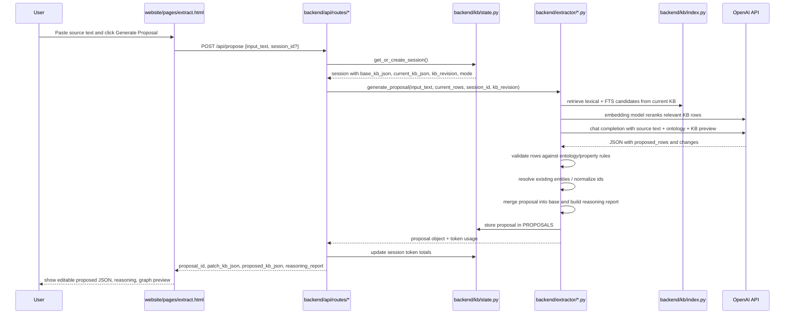
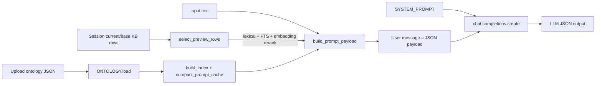

# TriExtract Artifact Flow

This document presents TriExtract as the implemented artifact that can be described in a Design Science Research (DSR) thesis. It is written to support both technical transparency and figure selection for the thesis narrative.

## 1. Thesis Reading Guide

The draw.io file contains five figure-ready views, each useful for a different part of the thesis:

- **Artifact Overview**: use when introducing the artifact at a high level.
- **Proposal Generation Pipeline**: use when explaining the core extraction cycle from user text to proposal.
- **LLM Input Construction**: use when explaining exactly what context is sent to the model.
- **Layered Architecture**: use when describing the structural decomposition of the artifact.
- **Session Lifecycle**: use when explaining the iterative append loop and final export path.

## 2. Core Terms

| Term | Meaning in the implementation | Why it matters in the thesis |
| --- | --- | --- |
| `base_kb_json` | The session seed graph, usually loaded from the default or uploaded base graph JSON | Defines the starting state of the artifact instance |
| `current_kb_json` | The mutable working graph after one or more approvals | Represents the artifact's evolving internal state |
| `delta_kb_json` | `rows_delta(base_kb_json, current_kb_json)` | Represents the net contribution produced during one session |
| `proposal` | A pending extraction result stored before approval | Supports the human-in-the-loop review step |
| Two-step QuickStatements | Export mode where new entities are created first and then bound in Step 2 | Handles deployment constraints in Wikibase Cloud |

## 3. Artifact Overview

```mermaid
flowchart TD
    U[User] --> S[Start Page<br/>Upload ontology + base graph]
    S -->|Upload ontology JSON| A1[/POST /api/upload-ontology]
    S -->|Upload existing KB query JSON| A2[/POST /api/upload-query]
    S --> E[Extraction Page<br/>Review proposal + append]

    E -->|Paste text + Generate Proposal| P[/POST /api/propose]
    P --> API[API Orchestration<br/>backend/api/routes/*]
    API --> ST[Session State<br/>backend/kb/state.py]
    API --> EX[Extraction Engine<br/>backend/extractor/*.py]
    EX --> ONT[Ontology Source JSON]
    EX --> IDX[Retrieval Index<br/>backend/kb/index.py]
    EX --> OAI[OpenAI Services<br/>embedding rerank + chat extraction]
    EX --> API
    API --> E

    E -->|Review/edit proposed JSON + Append| AP[/POST /api/approve]
    AP --> API
    API --> ST
    ST --> E

    E -->|Finalize| F[Finalize Page<br/>Delta JSON + Step 1 / Step 2 QuickStatements]
    F -->|Load session state| A3[/GET /api/state/{session_id}]
    F -->|Load base query rows| A4[/GET /api/default-query]
    F -->|Generate QuickStatements| A5[/GET /api/quickstatements/{session_id}]
    F -->|Resolve placeholders if needed| A6[/POST /api/quickstatements/{session_id}/step2]

    A5 --> CV[Export Generator<br/>backend/quickstatements/service.py]
    A6 --> CV
    CV --> F

    E --> G[Graph Renderer<br/>website/js/graph.js]
    F --> G
    G --> V[Interactive Cytoscape graph preview]
```

This view is the best entry-point figure for the thesis. It shows the artifact as a complete workflow that combines user interaction, backend orchestration, AI-assisted proposal generation, and export to Wikibase.

## 4. Responsibilities By Layer

### Presentation Layer

- `website/pages/start.html`: accepts ontology and base-graph uploads.
- `website/pages/extract.html`: supports text entry, proposal review, proposal editing, append, and preview.
- `website/pages/finalize.html`: presents the session delta, QuickStatements output, and final graph view.
- `website/js/graph.js`: renders the graph preview and distinguishes existing vs newly added nodes and edges.

### Application And State Layer

- `backend/main.py`: creates the FastAPI application, mounts static files, redirects `/`, and loads ontology data at startup.
- `backend/api/routes/*`: owns the HTTP routes and coordinates uploads, proposal generation, approval, session lookup, and export generation.
- `backend/kb/state.py`: manages `SESSIONS` and `PROPOSALS`, session creation, row deduplication, history, token totals, and delta computation.
- `backend/api/schemas.py`: defines the request schemas used by the API.
- `backend/core/config.py`: centralizes model names, file paths, host/port settings, and retrieval limits.

### Extraction And Export Logic

- `backend/extractor/llm.py`, `backend/extractor/retrieval.py`, `backend/extractor/entity_linking.py`, `backend/extractor/postprocess.py`, and `backend/extractor/service.py`: prepare the model input, retrieve relevant graph context, call OpenAI, validate the response, resolve existing entities, and package the proposal.
- `backend/kb/index.py`: creates a per-session SQLite FTS index over current KB rows to support fast retrieval.
- `backend/quickstatements/service.py`: converts session deltas into one-step or two-step QuickStatements and sanitizes rows for importability.
- `backend/core/prompt.py`: contains the system prompt that governs extraction behavior.

### External Dependencies

- OpenAI is used for embeddings and chat completions.
- Wikibase Cloud is the final deployment target for generated QuickStatements.

## 5. Proposal Generation Pipeline



This figure is well suited for the DSR evaluation or design explanation section because it shows the main value-producing cycle of the artifact: a human submits source text, the artifact constructs a proposal, and the user remains the final reviewer before the graph changes.

## 6. LLM Input Construction

The model does not receive raw text alone. The backend constructs a constrained, retrieval-informed payload with the following parts:

- normalized `source_text`
- compact `ontology` data derived from the active ontology store
- `existing_kb_preview_rows` selected through lexical matching, SQLite FTS, and embedding reranking
- `existing_kb_entity_catalog` for reusing existing entities by label
- `existing_kb_item_labels_sample`
- `required_output_schema`

The ontology is not embedded. The text embedding model is used only in the retrieval stage, where candidate KB rows are reranked before the chat completion request is sent.



This is the most useful figure when the thesis needs to justify how the artifact reduces unconstrained model behavior and improves alignment with the target ontology and current graph state.

## 7. Approval And Export Pipeline

```mermaid
flowchart TD
    A[User reviews proposal in extract.html] --> B[Optional: edit patch_kb_json in textarea]
    B --> C[/POST /api/approve]
    C --> D[Load session + proposal from in-memory stores]
    D --> E[Use edited_kb_json or proposal patch]
    E --> F[Merge into session current_kb_json]
    F --> G[Deduplicate rows]
    G --> H[Increment kb_revision and append history]
    H --> I[Session now contains approved graph state]

    I --> J[finalize.html]
    J --> K[/GET /api/state/{session_id}]
    J --> L[/GET /api/default-query]
    J --> M[/GET /api/quickstatements/{session_id}]

    M --> N{Any NEW placeholders left?}
    N -->|No| O[Single-step QuickStatements]
    N -->|Yes| P[Two-step output]
    P --> Q[Step 1: CREATE new items]
    Q --> R[User pastes created QIDs into placeholder mapping]
    R --> S[/POST /api/quickstatements/{session_id}/step2]
    S --> T[Step 2: bind placeholders and emit final statements]

    O --> U[Paste into Wikibase]
    T --> U
```

This figure is particularly useful when discussing how the artifact controls change. The graph is not modified directly by model output. Instead, proposal approval, deduplication, delta computation, and export preparation are explicit stages in the pipeline.

## 8. Data And State Model

The most important data transitions in the artifact are:

- Input text enters through `website/pages/extract.html`.
- `base_kb_json` defines the initial session graph when a base graph exists.
- `current_kb_json` is the active working graph used as retrieval context for subsequent rounds.
- `proposal_rows_only` represents validated candidate rows from the extractor.
- `patch_kb_json` represents only the newly added rows from the current proposal.
- `proposed_kb_json` represents the merged preview graph shown to the user.
- `delta_kb_json` represents the session contribution exported during finalization.

The key state distinction for the thesis is the difference between the working graph and the export graph:

- The working graph is `current_kb_json`.
- The export graph is `rows_delta(base_kb_json, current_kb_json)`.

This distinction is important because the artifact is designed to incrementally extend an existing graph while exporting only the net additions created during one session.

Exact duplicate triples are checked in code at three stages:

- during proposal validation, where duplicate rows returned by the model are removed
- during proposal merge and approval, where rows already present in the working graph are skipped or deduplicated
- during QuickStatements preparation, where export rows are deduplicated again for safe output

In contrast, near-duplicates are mainly discouraged through prompt instructions rather than a separate semantic duplicate-detection algorithm.

## 9. Iterative Append Loop

The artifact is designed around an iterative human-in-the-loop append cycle:

1. The user submits source text.
2. The backend generates a proposal using the current session graph as context.
3. The user reviews and optionally edits the proposed rows.
4. `/api/approve` appends the accepted rows into `current_kb_json`, deduplicates them, and increments `kb_revision`.
5. The updated working graph becomes the retrieval context for the next extraction round.
6. The cycle repeats until the user finalizes the session.

One implementation detail worth mentioning in the thesis is that `finalizeWithAppend()` automatically approves the latest pending proposal before opening the finalization page, ensuring that the final export reflects the complete visible working state.

## 10. Design Rationale Relevant To DSR

Several design decisions are especially relevant when explaining the artifact in DSR terms:

- **Human-in-the-loop control**: model output is treated as a proposal, not as an automatic graph mutation.
- **Retrieval-augmented extraction**: existing graph context is retrieved before the chat model call, and the embedding model is used only to rerank candidate context rows.
- **Session-based statefulness**: the artifact supports incremental graph construction across multiple extraction rounds.
- **Delta-oriented deployment**: only the net session additions are exported, which improves traceability and deployment control.
- **Separation of extraction and deployment**: proposal generation, approval, graph preview, and QuickStatements export are distinct steps rather than one opaque action.

These properties make the artifact easier to justify as a purposeful design intervention rather than a simple wrapper around an LLM API.
