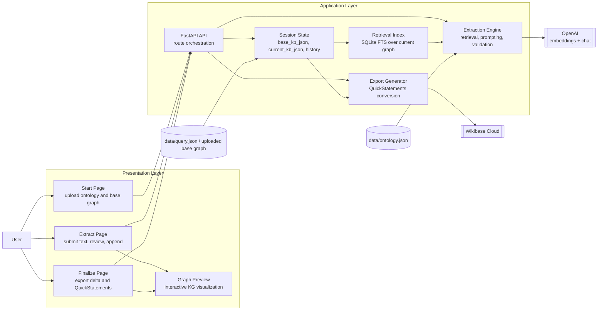
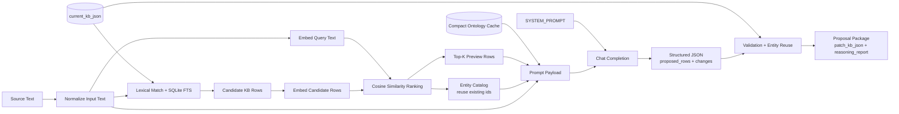
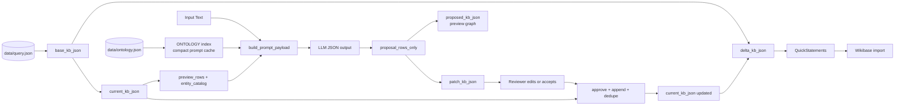

# Thesis Graph Pack

This file contains a cleaner, thesis-focused graph set for explaining how the TriExtract artifact works.
The goal is to make each figure communicate one main idea instead of mixing interface, backend, and export details in the same view.

## Figure 1. Artifact Overview

Use when: introducing the artifact in the results or demonstration chapter.

Main message: TriExtract is a human-in-the-loop artifact that connects a web interface, session state, ontology-constrained extraction, and Wikibase export.

Suggested caption: High-level overview of the TriExtract artifact, showing how user interaction, backend orchestration, AI-assisted extraction, and Wikibase export fit together.



What to say:

- The artifact has three visible user stages: start, extract, and finalize.
- The user never writes directly to Wikibase; the system creates proposals first and exports only after review.
- The session state is central because the working graph grows over multiple extraction rounds.

## Figure 2. LLM And Text Embedding Flow

Use when: explaining how the LLM is constrained and how embeddings are used.

Main message: the embedding model is used only for retrieval and reranking, while the chat model performs the actual structured extraction.

Suggested caption: Retrieval-informed prompt construction in TriExtract, separating embedding-based context selection from chat-based triple extraction.



What to say:

- The model does not receive raw text alone; it receives source text plus ontology constraints and retrieved graph context.
- Embeddings are not used to generate triples directly.
- This design reduces duplication by helping the chat model reuse existing entities and properties.

## Figure 3. End-To-End Data Flow

Use when: explaining the artifact through its main JSON objects and transformations.

Main message: TriExtract is a pipeline of explicit intermediate data structures, not a black-box LLM call.

Suggested caption: Main data objects and transformations in TriExtract, from uploaded files and source text to session delta and importable QuickStatements.



What to say:

- The important state distinction is between `current_kb_json` and `delta_kb_json`.
- `current_kb_json` is the evolving working graph.
- `delta_kb_json` is the net contribution of the current session and is what gets exported.

## Figure 4. Knowledge Graph Creation Loop

Use when: explaining how the graph is created iteratively and why the artifact is human-in-the-loop.

Main message: the knowledge graph is built through repeated propose-review-append cycles, and only approved rows become future context.

Suggested caption: Iterative knowledge graph construction in TriExtract, showing the human review loop and the final export path.

```mermaid
flowchart LR
    MODE[Start Session<br/>create_new or extend_existing] --> CUR[(current_kb_json)]
    CUR --> TXT[Submit New Source Text]
    TXT --> GEN[Generate Proposal]
    GEN --> REV[Human Review<br/>inspect reasoning and edit rows]
    REV --> APP[Approve and Append]
    APP --> DD[Deduplicate Rows<br/>increment kb_revision]
    DD --> CUR

    CUR --> FIN[Finalize Session]
    FIN --> D[rows_delta(base,current)]
    D --> S1[Step 1 QuickStatements<br/>create new entities if needed]
    S1 --> MAP[Bind placeholder QIDs]
    MAP --> S2[Step 2 QuickStatements<br/>final statements]
    S2 --> WB[Import into Wikibase]
```

What to say:

- Only approved rows are appended to the working graph.
- The updated working graph becomes retrieval context for the next extraction round.
- Export is separated from extraction, which improves traceability and control.

## Presentation Advice

If you only show one graph, use Figure 1.

If the examiner asks how the AI part works, switch to Figure 2.

If they ask about internal representations or state, use Figure 3.

If they ask how the graph is actually built over time, use Figure 4.
