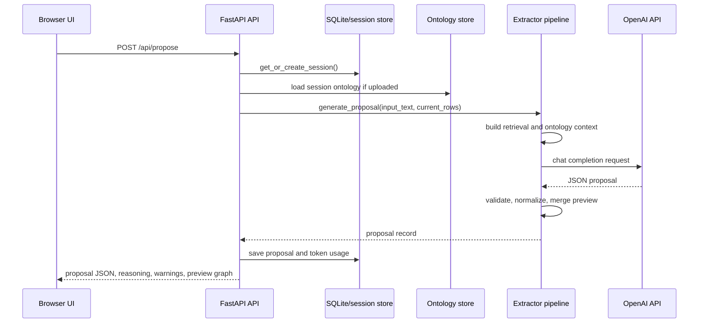

# Maintainer Guide

This guide is for technical readers who need to understand, review, or adapt the code after handover.

ORS Explorer is a single-process FastAPI application. The backend serves the static UI, accepts uploads, calls OpenAI, stores session state in SQLite, and exports approved changes.

## System Map

Runtime responsibilities:

- `app.py` creates the FastAPI app, mounts `/website`, registers routers, loads the startup ontology, and initializes storage.
- `backend/api.py` exposes API routes for health, upload, state, proposal generation, approval, and export.
- `backend/session_store.py` stores sessions and proposals in SQLite and writes session upload files under `APP_DATA_DIR/uploads/`.
- `backend/state.py` loads JSON, computes row keys, deduplicates rows, handles default session creation, and computes session deltas.
- `backend/extractor/pipeline.py` coordinates retrieval, prompt construction, the OpenAI call, response validation, post-processing, and proposal packaging.
- `backend/extractor/context.py` retrieves relevant existing rows and entity/source candidates for the model prompt.
- `backend/extractor/ontology.py` loads ontology rows, builds lookup indexes, and normalizes statement strings.
- `backend/extractor/postprocess.py` validates model output, applies ontology/modeling checks, merges proposal previews, and builds warnings.
- `backend/quickstatements.py` converts approved rows into single-step or two-step QuickStatements output.
- `website/` contains the three-page browser workflow and graph visualization.

## Request Flow



Approval is separate:

1. The UI posts `session_id`, `proposal_id`, and optional edited rows to `/api/approve`.
2. The backend loads the stored proposal and rejects it if its `kb_revision` is stale.
3. The approved rows are normalized and checked against required modeling rules.
4. The proposal patch is applied to the current session graph.
5. The session revision increments.
6. Export routes compute deltas by comparing the session base graph with the current graph.

## Frontend Workflow

| Page | File | Main script | Purpose |
| --- | --- | --- | --- |
| Configure | `website/pages/start.html` | `website/js/start.js` | Upload ontology and optional knowledge graph. Shows health/ontology status. |
| Extract | `website/pages/extract.html` | `website/js/extract.js` | Generate, review, edit, and approve proposals. |
| Export | `website/pages/finalize.html` | `website/js/finalize.js` | Show final JSON, QuickStatements, placeholder mapping, and graph preview. |

Browser session identifiers are stored in `localStorage` by `website/js/shared.js`. Server session data lives in SQLite.

The graph view uses Cytoscape loaded from a CDN in `extract.html` and `finalize.html`.

## State Model

Sessions are stored in `APP_DATA_DIR/app.sqlite3` with SQLite WAL mode enabled.

A session contains:

- `base_kb_json`: rows at the beginning of the session.
- `current_kb_json`: rows after approved proposals.
- `kb_revision`: revision counter used to reject stale proposal approval.
- `history`: approved proposal summaries.
- `token_usage_total`: accumulated OpenAI token usage reported by proposal generation.
- `warnings`: session warnings.
- `ontology_file`: optional session-specific uploaded ontology.
- `query_file`: optional session-specific uploaded base graph.

Proposals are stored separately and linked to `session_id`.

Uploads are stored under:

```text
APP_DATA_DIR/uploads/<session_id>/ontology.json
APP_DATA_DIR/uploads/<session_id>/query.json
```

Sessions expire after `SESSION_TTL_SECONDS`, which defaults to 7 days.

## Data Row Shape

Knowledge graph rows are JSON objects with fields such as:

```json
{
  "item": "https://organisational-rules.wikibase.cloud/entity/Q123",
  "itemLabel": "Example item",
  "property": "https://organisational-rules.wikibase.cloud/entity/P1",
  "propertyLabel": "instance of Class",
  "value": "https://organisational-rules.wikibase.cloud/entity/Q9",
  "valueLabel": "Declarative Rule Description",
  "qualifierProperty": "",
  "qualifierPropertyLabel": "",
  "qualifierValue": "",
  "qualifierValueLabel": "",
  "references": []
}
```

## Ontology Profile

The startup ontology is loaded from `ONTOLOGY_FILE`, defaulting to `user_data_editable/ontology.json`.

The ontology profile in `backend/core/ontology_profile.py` is the main place to adapt the app to a different Wikibase ontology. Review these settings before using another ontology:

- `ENTITY_BASE_URI`
- model/classification property labels
- source and reference property labels
- rule-like and source-like class labels
- prioritized concept labels
- disallowed extractor property IDs
- `SHAPE_DEFINITIONS`

After changing the profile, upload or place a matching `ontology.json` and check `/health` for `ontology_load_error`.

## API Surface

Key routes:

| Route | Method | Purpose |
| --- | --- | --- |
| `/health` | GET | Root health and config summary. |
| `/api/health` | GET | API health and config summary. |
| `/api/upload-ontology` | POST | Upload session ontology JSON array. |
| `/api/upload-ontology` | DELETE | Remove session ontology upload. |
| `/api/upload-query` | POST | Upload session base knowledge graph JSON array. |
| `/api/upload-query` | DELETE | Remove session base graph upload. |
| `/api/default-query` | GET | Return server or session base graph rows. |
| `/api/propose` | POST | Generate a model proposal. |
| `/api/approve` | POST | Approve a stored proposal patch. |
| `/api/state/{session_id}` | GET | Return current session state, delta, and warnings. |
| `/api/quickstatements/{session_id}` | GET | Generate QuickStatements export. |
| `/api/quickstatements/{session_id}/step2` | POST | Generate mapped Step 2 QuickStatements. |

## Invariants To Preserve

When changing backend behavior, protect these constraints:

- The app must boot even if the server-level ontology file is missing or invalid.
- Proposal generation must fail clearly when no valid ontology is available.
- Model output must be a JSON object with `proposed_rows` and `changes`.
- Each proposed row should have one aligned change entry.
- Proposal approval must reject stale revisions.
- Approved edits apply as patches, not as wholesale replacement of the session state.
- Delta export is based on `base_kb_json` versus `current_kb_json`.
- QuickStatements must handle placeholder subjects with the two-step flow.
- Upload paths must stay session-scoped and path-safe.
