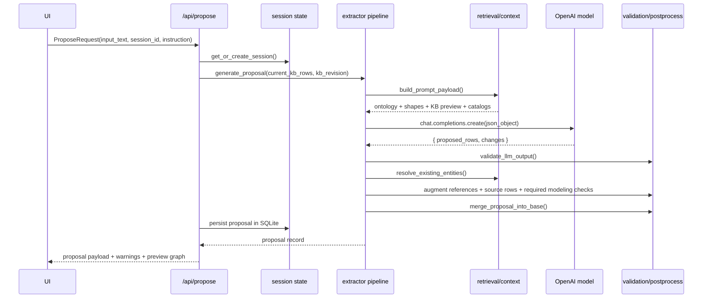

# Maintainer Guide

## System Map

The app is one FastAPI service with three responsibilities:

- Serve the static UI from `website/`
- Expose the JSON API from `backend/api.py`
- Persist session and proposal state in SQLite through `backend/session_store.py`

High-level runtime flow:

1. `app.py` creates the FastAPI app, mounts `/website`, registers routers, and loads the ontology at startup.
2. `backend/api.py` handles uploads, proposal generation, approval, state reads, and QuickStatements export.
3. `backend/extractor/pipeline.py` builds the prompt payload, calls the model, validates the response, normalizes it, and stores a proposal snapshot.
4. `backend/extractor/postprocess.py` is the final gate for proposal cleanup, merge behavior, reasoning normalization, and required modeling checks.
5. `backend/quickstatements.py` converts approved delta rows into one-step or two-step QuickStatements output.

## Proposal Lifecycle

## Approval And Export Flow

After proposal generation, the rest of the system is patch-oriented rather than prompt-oriented:

1. `/api/approve` loads the proposal from SQLite by `session_id` and `proposal_id`, then rejects it if its `kb_revision` is stale relative to the current session.
2. Approval applies `patch_kb_json`, not the full preview graph. This is why proposal records store both `patch_kb_json` and `proposed_kb_json`.
3. The session's `current_kb_json` becomes the new working graph and `kb_revision` increments.
4. `/api/quickstatements/{session_id}` computes the session delta against the session base graph.
5. If placeholder subjects such as `NEW:entity_1` remain, export switches to the two-step QuickStatements flow.

## Module Guide

- `app.py`: App factory, route mounting, ontology startup load.
- `backend/api.py`: API entrypoints and session-facing orchestration. Start here for request flow.
- `backend/session_store.py`: SQLite-backed session/proposal storage and session upload paths.
- `backend/state.py`: Row deduplication, delta computation, default session creation helpers, FTS index cache.
- `backend/extractor/pipeline.py`: End-to-end extraction pipeline.
- `backend/extractor/context.py`: Prompt context assembly, retrieval, label matching, placeholder/entity resolution, embedding reranking.
- `backend/extractor/ontology.py`: Ontology store, property validation, row normalization helpers.
- `backend/extractor/postprocess.py`: Output validation, merge behavior, warning generation, required `NEW:*` modeling checks.
- `backend/core/config.py`: Environment-backed config and OpenAI client creation.
- `backend/core/ontology_config.py`: Ontology-specific extraction policy, vocabulary labels, export hooks, disallowed properties, and shape definitions most likely to change with a new ontology.
- `backend/core/prompt.py`: Extractor system prompt and behavioral rules.

## State Model

- Sessions and proposals live in local SQLite at `data/app.sqlite3` by default.
- SQLite runs in WAL mode for ordinary single-server concurrency.
- Session uploads live under `data/uploads/<session_id>/`.
- Sessions expire after 7 days by default and cleanup removes expired uploads.
- Uploading a new ontology or query file only affects the owning session.

## Invariants Worth Protecting

If you change extractor or approval logic, preserve these behaviors:

- Model output must be a JSON object with exactly `proposed_rows` and `changes`
- `NEW:*` placeholders are allowed only in `item`, never in `value` or `qualifierValue`
- Each proposed row must have exactly one aligned `changes` entry
- Property fields must use ontology property URIs, not labels or bare `P123`
- Proposal approval must reject stale proposals using `kb_revision`
- New placeholder subjects must receive required modeling rows
- QuickStatements export is based on session delta, not the latest proposal preview

## Where To Start When Debugging

- Bad or missing proposal rows: start in `backend/extractor/pipeline.py`
- Duplicate reuse problems or wrong preview context: inspect `backend/extractor/context.py`
- Rows disappearing, editing the wrong target, or merge surprises: inspect `backend/extractor/postprocess.py`
- Session mismatch, stale approval, or missing payload fields: inspect `backend/api.py` and `backend/state.py`
- Export issues or unresolved placeholders: inspect `backend/quickstatements.py`

## Local Sanity Checklist

Before shipping backend behavior changes, manually verify:

1. `/health` reports the expected ontology path and model settings
2. `/api/propose` works with a loaded ontology
3. A proposal can be approved once and is rejected after the session changes
4. `/api/state/{session_id}` reflects the updated delta rows
5. QuickStatements still works for both normal rows and placeholder-subject rows
